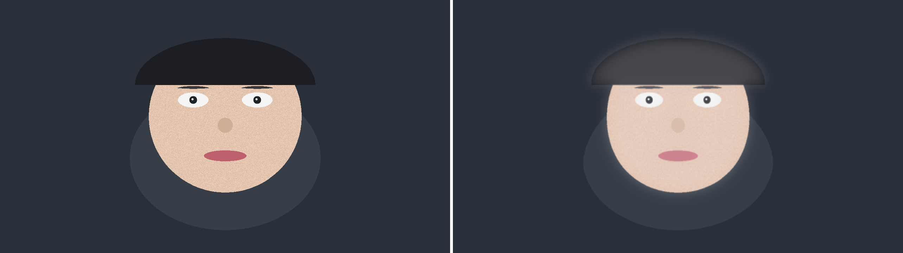

# OBS 美颜摄像头 / OBS Beauty Cam

给 OBS 直播用的美颜摄像头。两种用法，一套算法：

| 方案 | 形态 | 状态 |
|---|---|---|
| **A. BeautyCam 应用** | 独立程序，处理摄像头画面后推到 **OBS 虚拟摄像头**，OBS 里当普通采集设备用 | 已打包、已实测 |
| **B. obs-beauty-filter 插件** | OBS 原生滤镜，C + GLSL，直接挂在任意来源上 | Windows x64 已编译，实机加载待验证 |

美颜算法全部自研，没有依赖任何商业人脸 SDK：YCrCb 肤色掩膜 + 引导滤波保边磨皮 + 明度/暖调重映射 + USM 锐化 + 椭圆向心变形（瘦脸）。

## 效果与性能

1280×720，Python 实现，打包后的 exe 实测：

| 指标 | 结果 |
|---|---|
| 单帧耗时 / 帧率 | 25–27 ms / **37–40 fps**（默认 0.75 渲染缩放）；全分辨率 43 ms / 23 fps |
| 磨皮强度 | 皮肤高频纹理能量 **下降 84.6%** |
| 美白 | L 通道 **+12.3** |
| 瘦脸 | 脸宽 495 → 478 px（强度 0.35） |

效果对比图不在仓库里（避免二进制），运行 `BeautyCam.exe --selftest` 会在 `out_selftest/selftest_compare.png` 生成。

## 方案 A：BeautyCam

### 下载

装好的包在 [Releases](https://github.com/wangsansui963/obs-beauty-cam/releases/latest)：

- `BeautyCam-Setup-1.0.0.exe`（65 MB）—— 双击安装，免配置
- `BeautyCam-win64.zip`（58 MB）—— 便携版，解压后跑 `install.bat`

> 未做代码签名，SmartScreen 可能提示"未知发布者"，选「仍要运行」即可。

### 用

1. 先装 **OBS Studio**（虚拟摄像头驱动由 OBS 提供，这是前提）
2. 双击安装包，或解压便携版后双击 `install.bat`
3. 打开 BeautyCam，浏览器会自动弹出控制面板；选摄像头 → 点【开始】
4. OBS 里添加来源 **视频采集设备**，设备选 `OBS Virtual Camera`

没有摄像头也能看效果：`BeautyCam.exe --demo`，用合成人像演示。

控制面板是本地 HTTP 服务（`127.0.0.1`）+ 浏览器页面，不依赖 tkinter/Qt，换机器不会因为缺 GUI 库起不来。参数存 `%APPDATA%\BeautyCam\profile.json`。

### 可调项

磨皮、美白、红润、锐化、瘦脸、大眼强度，人脸自动定位开关（Haar 级联），镜像画面，渲染缩放（性能/画质权衡），输出分辨率。

### 构建

```bash
pip install numpy opencv-python pyvirtualcam pyinstaller
python tools/make_icon.py     # 生成图标
python build.py               # 产物 dist/BeautyCam/BeautyCam.exe（onedir，约 146MB）
python package.py             # 组装 release/ + BeautyCam-win64.zip
python make_setup.py          # 单文件安装包（Windows 自带 IExpress，无需 NSIS）
```

## 方案 B：obs-beauty-filter

OBS 原生滤镜，纯 GPU 计算，挂在任意来源上右键即可添加。

```bash
# 需要 VS 2022 + OBS 源码/source 目录
set OBS_SOURCE_DIR=C:\path\to\obs-studio
build-windows.bat
```

仓库带 GitHub Actions 工作流（`.github/workflows/build.yml`），推到 GitHub 上可以直接出包。

**注意**：这份代码没有在真实 OBS 环境里编译过，接口用的是 OBS 一直稳定的 `obs_source_process_filter_begin/end` 那一套，但请当作"待验证的工程骨架"看待。

## 算法

```
帧 → (可选) 人脸检测定位 → 几何变形(瘦脸)
   → 肤色掩膜 (YCrCb 阈值, 软权重)
   → 磨皮: 半分辨率引导滤波求平滑层 → 放大 → 按 mask 做 blendLinear
   → 美白/红润: 向白色插值 + 中间调偏暖
   → 锐化: 亮度域 USM, 皮肤区抑制
   → uint8 输出
```

几个关键选择：

- **只在皮肤区生效**。所有重映射都乘肤色掩膜，头发、眼睛、背景不动，所以不会整体糊。
- **磨皮走低分辨率**。平滑层本质是低频信息，半分辨率算完再放大，质量几乎无损，时间省一大截。
- **保边靠引导滤波**。普通高斯会把五官边缘也抹掉，引导滤波以原图亮度为引导，边缘处增益趋近 1。

### 性能踩过的坑（Python/NumPy）

| 写法 | 慢在哪 | 换掉之后 |
|---|---|---|
| `img[...] *= w[..., None]` | NumPy 广播乘法比 `cv2.multiply` 慢约 3 倍 | `cv2.multiply` + `cv2.merge` |
| `np.clip(f,0,255).astype(np.uint8)` | 两遍遍历 | `cv2.addWeighted(..., dtype=CV_8U)`，带饱和截断，快 3 倍 |
| 全分辨率算引导滤波 | 720p 下 ~120 ms | 半分辨率算再放大 |

最终 720p 从 4 fps 提到 37 fps。

## 目录

```
beautycam/                    方案 A：应用
  src/beautycam/imgops.py       算法原语（掩膜/磨皮/色调/锐化/变形）
  src/beautycam/pipeline.py     流水线编排 + 参数缓存
  src/beautycam/facetrack.py    人脸定位
  src/beautycam/camera.py       采集 + 虚拟摄像头推流
  src/beautycam/webui.py        控制面板后端
  src/beautycam/assets/web/     控制面板前端
  src/beautycam/selftest.py     合成人像自测（出指标 + 对比图）
obs-beauty-filter/            方案 B：OBS 原生滤镜
  src/beauty-filter.c           滤镜实现
  data/shaders/beauty.effect    GPU 版本
```

## 已知限制

- 虚拟摄像头依赖 OBS 的驱动；不装 OBS 就只是本地预览。
- 人脸检测用 Haar 级联，正脸、光照正常时稳，侧脸和大角度会丢；需要更稳可以换 ONNX 轻量模型。
- 方案 B 未编译验证。
- Python 实现单线程跑 CPU，高分辨率下建议开渲染缩放；要 4K 60fps 得走方案 B 的 GPU 路径。

## 许可

MIT，见 [LICENSE](LICENSE)。算法与代码均为独立实现。


## 效果对比



左：原图；右：处理后（磨皮 0.75 / 美白 0.45 / 红润 0.3 / 锐化 0.35 / 瘦脸 0.35）。皮肤纹理被抹平，五官与头发细节保留，没有色偏和接缝。

## Windows 64 位原生滤镜安装

下载和完整安装使用步骤请见 [滤镜安装说明](obs-beauty-filter/INSTALL.md)。

